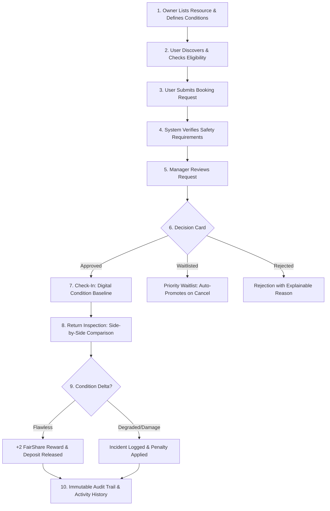

# 🏛️ EquiShare — Institutional Shared Equipment & Resource Governance

> **Problem Statement:** Unlock Underused Equipment and Spaces  
> **One-Line Description:** A trusted platform that helps universities, research institutes, makerspaces, and communities safely share underused high-value equipment, spaces, and fabrication tools with verified operator eligibility, before/after condition audits, and explainable fair-use allocation.

---

## 🚀 Live Demo & Repository
- **GitHub Repository:** [https://github.com/muskan5572/codehack-equishare](https://github.com/muskan5572/codehack-equishare)
- **Live Deployment:** [Vercel Deployment URL](https://equishare.vercel.app) *(or run locally via `npm run dev` on `http://localhost:3000`)*

---

## 🎯 1. Selected Use Case & Evidence

### The Problem
Universities, makerspaces, and research hubs own millions of dollars worth of specialized assets—including **5-Axis CNC Mills, Scanning Electron Microscopes (SEM), 120W Laser Cutters, High-End Bio-Safety Cabinets, and 8K Cinema Rigs**—that sit idle **60–75% of the time**. 

Simultaneously, student researchers, interdisciplinary creators, and early-stage startup teams cannot afford access. Standard booking calendars fail because they ignore critical institutional barriers:
1. **Liability & Safety Risk:** Hazardous equipment requires verified operator certifications (e.g. Laser Safety Level 2, Cleanroom Level 100).
2. **Accountability Gap:** Unclear baseline condition before vs. after usage leads to unaddressed damage and disputes.
3. **Monopolization & Hoarding:** Well-funded senior labs monopolize peak slots while newcomers are blocked.

### The Solution: EquiShare
EquiShare closes this governance gap by transforming ordinary resource booking into an **institutional trust and accountability loop**:
- **Prerequisites & Eligibility Engine:** Automated qualification checks against campus safety databases.
- **FairShare™ Allocation Algorithm:** Dynamic reputation scores, cooldown rules, and cross-department collaboration incentives to prevent monopolization.
- **Digital Condition Baseline:** Pre-use safety check-in vs. post-use return inspection with side-by-side discrepancy detection.
- **Human-in-the-Loop Oversight:** Explanatory decision cards for lab managers with an immutable audit ledger.

---

## 👥 2. Demo Personas & Evaluation Credentials

For seamless evaluation, EquiShare includes a **1-Click Judge Role Switcher** at the top of every screen:

| Persona | Role | Department | Testing Purpose |
| :--- | :--- | :--- | :--- |
| **Dr. Aris Thorne** | Lab Director & Approver | Robotics & Fabrication Institute | Approves/rejects booking requests with explainable reasons, verifies submitted safety credentials, oversees damage disputes. |
| **Maya Lin** | Verified Senior Researcher | Materials Science & Bioengineering | Holds verified Laser Safety & Cleanroom certificates. Eligible to book immediately, complete check-in baseline, and return equipment. |
| **Alex Rivera** | Undergrad Student | Mechanical Engineering | Unverified operator. Demonstrates eligibility blockage, submitting safety certifications, and transparent waitlist queuing. |

---

## 🔄 3. Complete 10-Step Lifecycle Workflow

EquiShare implements the complete lifecycle required by the challenge:



1. **Listing & Conditions:** Owners configure safety prerequisites, max duration limits (e.g., 4h), cooldown windows (e.g., 24h), and deposit holds.
2. **Discovery & Smart Matching:** Search and filter by category (Fabrication, Laboratory, Media & AV) with real-time eligibility tags.
3. **Reservation Request:** Select timeslots, specify academic purpose, and preview Fair-Use quota impact.
4. **Prerequisites & Anti-Monopoly Check:** Automated validation of operator credentials and active reservation limits (max 2 concurrent).
5. **Human-in-the-Loop Review:** Approver reviews applicant's FairShare score, department affiliation, and appointed faculty supervision.
6. **Transparent Allocation:** Approved, rejected with mandatory rationale, or placed on a priority queue.
7. **Step 7: Check-In Baseline:** User completes pre-flight safety checklist (emergency stop, calibration, cleanliness rating 1–5, and photo baseline) before unlock.
8. **Step 8: Return Handover:** User returns resource with post-flight checklist and side-by-side condition comparison against check-in baseline.
9. **Discrepancy & Incident Governance:** Automatic degradation alert if returned in inferior condition; opens formal incident ticket.
10. **Immutable Compliance Ledger:** Every state change, timestamp, actor, and decision reason is logged in a tamper-evident audit ledger.

---

## ⚖️ 4. FairShare™ Anti-Monopolization System

To prevent equipment monopolization and ensure democratic access, EquiShare applies explainable allocation rules:

$$\text{FairShare Score} = \text{Base Reputation} (100) - \text{Active Hold Penalty} - \text{Resource Weight} + \text{Cross-Department Bonus} (+10)$$

- **Mandatory Cooldowns (12h–48h):** Users cannot immediately re-book the same heavy tool, giving others a fair turn.
- **Cross-Silo Incentive (+10 Pts):** Encourages cross-department collaboration (e.g., Bioengineering students booking Robotics tools).
- **Concurrent Reservation Cap:** Maximum 2 concurrent active reservations per researcher.
- **Reputation Rewards:** Users returning tools clean and on time earn +2 reputation points per session.

---

## 🛠️ 5. Technology Stack & Architecture

- **Frontend:** Next.js 14 (App Router), React 18, TypeScript, Tailwind CSS
- **Design System:** Lucide Icons, Glassmorphism UI tokens, `clsx`, `tailwind-merge`
- **Database & RLS:** Supabase (PostgreSQL with Row-Level Security policies)
- **Data Layer:** Hybrid reactive store with instant local caching and Supabase synchronization
- **Feedback & Animations:** `canvas-confetti` for celebratory approvals and condition confirmations

---

## 💻 6. Quick Start & Testing Instructions

### Local Development
```powershell
# 1. Clone repository
git clone https://github.com/muskan5572/codehack-equishare.git
cd codehack-equishare

# 2. Install dependencies
npm install

# 3. Run development server
npm run dev
```

Open [http://localhost:3000](http://localhost:3000) in your browser.

### Recommended 3-Minute Judge Walkthrough:
1. **Browse as Maya Lin:** Notice the green *"Verified & Ready"* badge on the Scanning Electron Microscope. Click **Request Access** and submit a reservation.
2. **Switch to Dr. Aris Thorne (Manager):** Click the top **Review & Approvals** tab. View Maya's 94/100 FairShare score. Type an approval note and click **Approve Reservation** (celebratory confetti triggers).
3. **Switch back to Maya Lin:** Navigate to **Reservations**. Click **Step 7: Check-In Baseline**. Fill out the safety checklist and confirm check-in.
4. **Complete Handover:** Click **Step 8: Return Inspection**. Observe the side-by-side comparison with the check-in baseline. Confirm return to earn +2 FairShare points!
5. **View Compliance Ledger:** Click **Audit Trail** to see the complete, timestamped history of every decision.

---

## 🔒 7. Privacy, Security & Disclosures
- **Privacy:** Operator personal records and credentials are protected; only authorized lab managers view full certification details.
- **Safety Oversight:** No automatic system can bypass physical safety or operator training requirements.
- **Templates & Pre-existing Code:** Built from a clean Next.js 14 template during the official hackathon window. Open-source libraries used: `@supabase/supabase-js`, `lucide-react`, `tailwindcss`, `canvas-confetti`.

---
*Built with passion for the CodeHack Hackathon 2026.*
