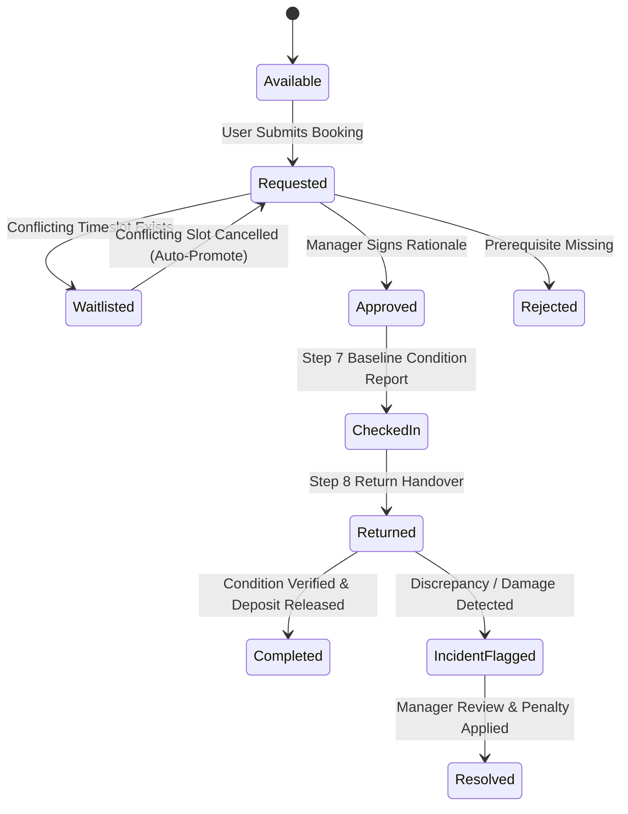

# EquiShare System Architecture & Data Flow

## 1. High-Level Architecture Overview

EquiShare is engineered using Next.js 14 App Router, TypeScript, and Supabase PostgreSQL with Row Level Security (RLS). It uses an event-driven state model to enforce physical and institutional access constraints.

```
+------------------------------------------------------------------------+
|                          PRESENTATION LAYER                            |
|  - RoleSwitcher (Judge Persona Sandbox: Manager / Researcher / Student)|
|  - Catalog & Search (Live Prerequisite Validation Badges)              |
|  - Handover Terminal (Step 7 Check-In & Step 8 Return Comparison)      |
|  - Human-in-the-Loop Review Desk (Dr. Aris Thorne Approver Portal)     |
|  - Compliance Ledger (Tamper-evident JSON Metadata Inspector)          |
+------------------------------------------------------------------------+
                                    |
                                    v
+------------------------------------------------------------------------+
|                         APPLICATION ENGINE                             |
|  - FairShare(TM) Anti-Monopoly Cooldown Algorithm                      |
|  - Priority Waitlist Auto-Promotion Engine                             |
|  - Condition Degradation & Discrepancy Detector                        |
|  - Reputation Incentive Engine (+2 reward on flawless return)          |
+------------------------------------------------------------------------+
                                    |
                                    v
+------------------------------------------------------------------------+
|                         PERSISTENCE & SECURITY                         |
|  - Supabase PostgreSQL with RLS Policies                               |
|  - Immutable Audit Activity Ledger                                     |
|  - Reactive Local Hydration Fallback Cache                             |
+------------------------------------------------------------------------+
```

## 2. State Machine for Shared Resources



## 3. Security & Row-Level Permissions (RLS)
- **Role Isolation:** Managers have write access to approval and incident tables; students have write access to their own bookings and credential uploads.
- **Audit Tamper-Resistance:** Audit logs are append-only. No deletion or back-dating is permitted by database policies.
